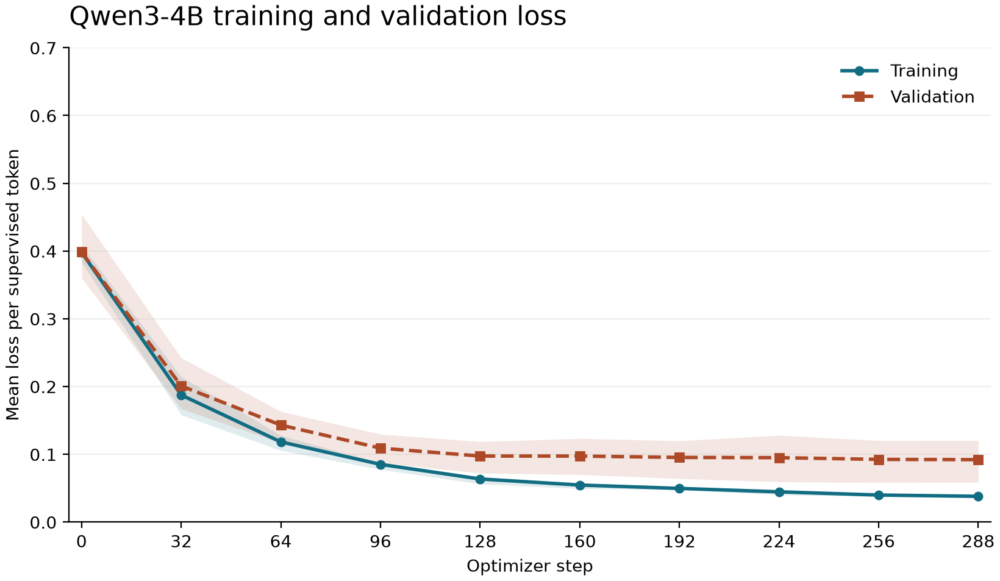
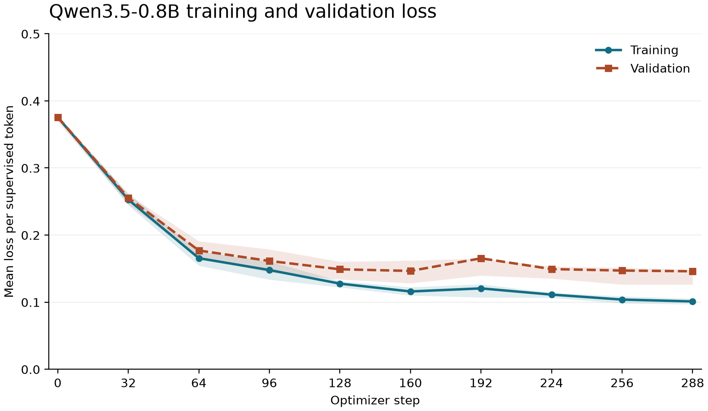
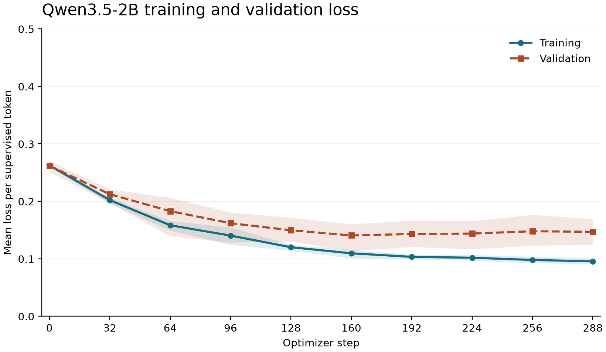

# Qwen permission decisions on held-out queries

The 1,444 decisions cover 169 queries (871 Yes and 573 No). Each seed (42, 43, 44) assigns whole queries to five folds shared by all four models. Each adapter trains on four folds for two epochs with an effective batch size of eight and is evaluated on the fifth fold.

| Model | Weights | Accuracy (%) | Macro-F1 | FP | FN | FPR (%) | FNR (%) |
|---|---|---:|---:|---:|---:|---:|---:|
| Qwen3-4B | Raw | 86.84 | 0.8616 | 106 | 84 | 18.50 | 9.64 |
| Qwen3-4B | SFT | 95.66 ± 0.11 | 0.9546 ± 0.0011 | 34.00 ± 2.65 | 28.67 ± 3.06 | 5.93 ± 0.46 | 3.29 ± 0.35 |
| Qwen3-8B | Raw | 84.97 | 0.8479 | 38 | 179 | 6.63 | 20.55 |
| Qwen3-8B | SFT | 94.76 ± 0.26 | 0.9451 ± 0.0027 | 41.67 ± 1.15 | 34.00 ± 4.58 | 7.27 ± 0.20 | 3.90 ± 0.53 |
| Qwen3.5-0.8B | Raw | 45.29 | 0.3837 | 4 | 786 | 0.70 | 90.24 |
| Qwen3.5-0.8B | SFT | 91.14 ± 0.42 | 0.9076 ± 0.0044 | 61.00 ± 5.00 | 67.00 ± 1.00 | 10.65 ± 0.87 | 7.69 ± 0.11 |
| Qwen3.5-2B | Raw | 76.52 | 0.7617 | 109 | 230 | 19.02 | 26.41 |
| Qwen3.5-2B | SFT | 91.37 ± 0.22 | 0.9100 ± 0.0022 | 60.00 ± 1.00 | 64.67 ± 3.21 | 10.47 ± 0.17 | 7.42 ± 0.37 |

Raw denotes the original weights evaluated once on the same 1,444 decisions. For SFT, each repeat pools one out-of-fold prediction per decision. Entries show the mean ± sample standard deviation across three repeats. FP counts incorrect access grants and FN counts incorrect denials. All evaluated outputs were valid Yes/No decisions.

## Training and validation loss

For Qwen3-4B and Qwen3-8B, loss measurements come from a second run of the same 30 fits. For Qwen3.5-0.8B and Qwen3.5-2B, the 30 fits used for the prediction table also produced the loss measurements. At each marked step, both losses were measured at the same weights with dropout disabled, across all examples in the training folds and the held-out validation fold. Each loss is the mean negative log-likelihood over the answer and end-of-turn tokens. Each held-out fold supplied the monitoring losses and the final evaluation. The table uses the prespecified two-epoch checkpoint in every fold.

Each point is the arithmetic mean of 15 fold measurements for one model. Shading shows the 25th to 75th percentiles across those fits. Panels within each model family share the same axis limits. Measurements start before training and repeat every 32 optimizer steps. The plots end at the last shared step (288). Depending on fold size, training ended at step 288, 290 or 292.
