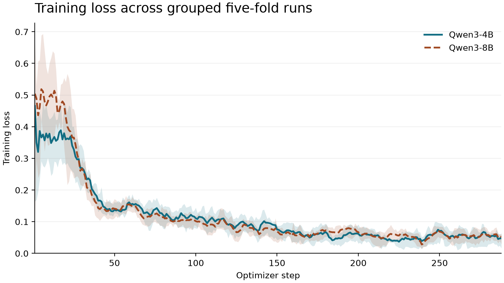

# Qwen3 permission decisions on held-out queries

The 1,444 decisions cover 169 queries (871 Yes and 573 No). Each seed (42, 43, 44) assigns whole queries to five folds shared by both models. Each adapter trains on four folds for two epochs with an effective batch size of eight and is evaluated on the fifth fold.

| Model | Weights | Accuracy (%) | Macro-F1 | FP | FN | FPR (%) | FNR (%) |
|---|---|---:|---:|---:|---:|---:|---:|
| Qwen3-4B | Raw | 86.84 | 0.8616 | 106 | 84 | 18.50 | 9.64 |
| Qwen3-4B | SFT | 95.66 ± 0.11 | 0.9546 ± 0.0011 | 34.00 ± 2.65 | 28.67 ± 3.06 | 5.93 ± 0.46 | 3.29 ± 0.35 |
| Qwen3-8B | Raw | 84.97 | 0.8479 | 38 | 179 | 6.63 | 20.55 |
| Qwen3-8B | SFT | 94.76 ± 0.26 | 0.9451 ± 0.0027 | 41.67 ± 1.15 | 34.00 ± 4.58 | 7.27 ± 0.20 | 3.90 ± 0.53 |

Raw denotes the original weights evaluated once on the same 1,444 decisions. For SFT, each repeat pools one out-of-fold prediction per decision. Entries show the mean ± sample standard deviation across three repeats. FP counts incorrect access grants and FN counts incorrect denials. All evaluated outputs were valid Yes/No decisions.

Each line averages 15 runs per model after smoothing each run with a trailing 10-step mean (shorter windows for the first nine steps). Shading spans the 25th to 75th percentiles across runs. The curves end at step 288, the last step shared by all runs. Individual runs ended at steps 288–292. The runs logged training loss at each update and evaluated held-out decisions after training. No per-step validation loss was recorded.
